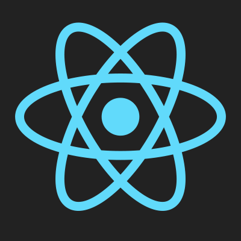

  

  # React365: My Odyssey Through Code

This isn't your typical GitHub repository. It's a private playground, a year-long experiment in self-discovery, fueled by React and powered by me. Every day, for 365 days (leap years, you sneaky devils, are included!), I'll commit a simple React project. Why? Well, that's the interesting part.

See, I'm tired of staring at the blank page, paralyzed by the pressure of "the next big thing." I want to rediscover the joy of creation, the thrill of building something, anything, from scratch. React365 is my antidote to creative paralysis, my daily dose of pixelated therapy.

Each project won't be a masterpiece, a polished gem for the portfolio gods. They'll be messy sketches, playful experiments, sometimes nonsensical contraptions held together by duct tape and caffeine. But each one will be a victory, a testament to showing up, to putting one line of code in front of the other.

This isn't about impressing anyone but myself. It's about pushing my boundaries, exploring uncharted corners of the React universe, and maybe, just maybe, learning a thing or two along the way. Sure, the occasional project might end up as digital landfill, but hey, even garbage teaches you something, right?

And who knows, maybe along the way, I'll stumble upon a hidden gem, a nugget of code that sparks something bigger. But that's not the point. This is a solo mission, a chance to reconnect with the raw joy of coding, the satisfaction of building something from nothing.

So, if you stumble upon this repository, consider it a peek into my personal laboratory. Don't expect polished perfection, just raw experimentation, fueled by caffeine and an unhealthy obsession with semicolons. Feel free to join in, offer feedback, or simply watch from the sidelines as I embark on this year-long coding odyssey.

> This is my React365. My journey. My code. And maybe, just maybe, a testament to the power of small, consistent steps, one line of code at a time.
